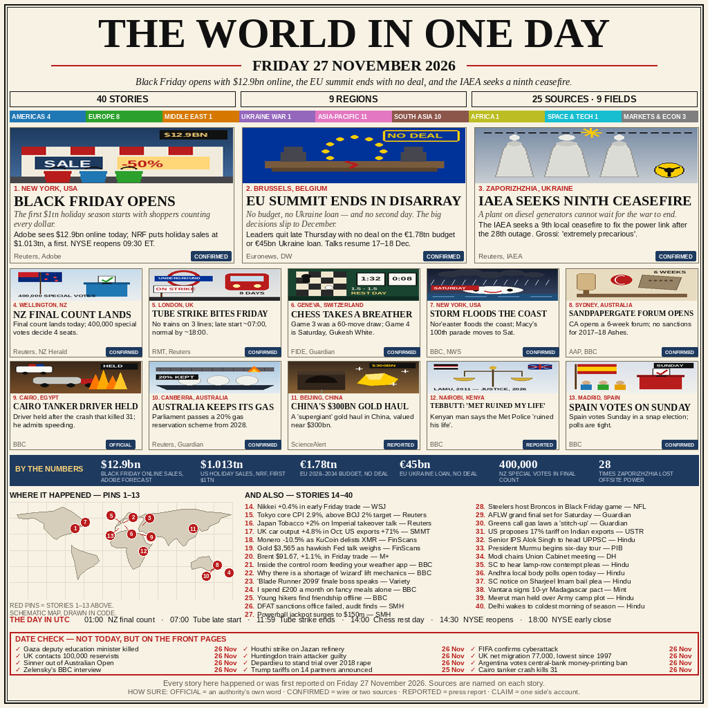

# Friday 27 November 2026 — The World in One Day

**The World in One Day** — one image that sums up Friday 27 November 2026:
**40 stories, 9 regions, 25 sources, 9 fields.**

## What is on the page

- **Masthead** — "THE WORLD IN ONE DAY" in clean newspaper serif, with the full
  date, a one-line deck, stat boxes (40 stories · 9 regions · 25 sources · 9
  fields) and a region bar with per-region counts computed from the story list.
- **3 heroes, each with a drawn scene** — Black Friday opens with $12.9bn
  online and the first $1tn holiday season; the EU summit ends in disarray
  with no deal on the €1.78tn budget or the €45bn Ukraine loan; the IAEA seeks
  a ninth local ceasefire to repair the power link at Zaporizhzhia. Every hero
  carries a "WHY IT MATTERS" line under its headline.
- **10 more illustrated stories** — New Zealand's final count lands; the Tube
  strike bites on Friday; the world chess title match takes a rest day; a
  nor'easter floods the US coast and moves Macy's 100th parade to Saturday;
  the sandpapergate forum opens; the Cairo tanker driver is held; Australia
  passes its 20% gas reservation scheme; a 'supergiant' gold haul in China;
  the Tebbutt case man says the Met Police 'ruined my life'; Spain votes on
  Sunday.
- **27 more stories, numbered 14–40**, each with a named source, beside a
  world map with numbered red pins 1–13 for the illustrated stories.
- **BY THE NUMBERS** — $12.9bn · $1.013tn · €1.78tn · €45bn · 400,000 · 28.
- **THE DAY IN UTC** — six timed entries, all Friday.
- **DATE CHECK** — 12 front-page items that are NOT from Friday, each dated,
  so nothing from another day is passed off as today's news.
- **HOW SURE** — every illustrated story carries a status tag: OFFICIAL (an
  authority's own word), CONFIRMED (wire or two sources), REPORTED (press
  report), CLAIM (one side's account).

## How it was built

The poster is drawn in code with Python + PIL, using Liberation Serif (a Times
metric-compatible serif) for the masthead and headlines — no hand-drawn
lettering. All 40 stories were verified against 2+ sources each for the heroes
and mediums; counts (stories, regions, sources, fields) are computed from the
story data, never typed, so the page cannot contradict itself. The program in
this repo (`main.ts`) copies `entry.png` to `$MAKEFUN_OUTPUT_DIR`, the pattern
the competition kit itself ships.

Round 1 of this competition, built on the proven pattern of 26 November's
round 3 (serif type, WHY IT MATTERS, HOW SURE, 40 stories, date check) after
that day's round 2 placed #5,738 with judge 954.336 — about 32.6 points below
the top-50 line.
